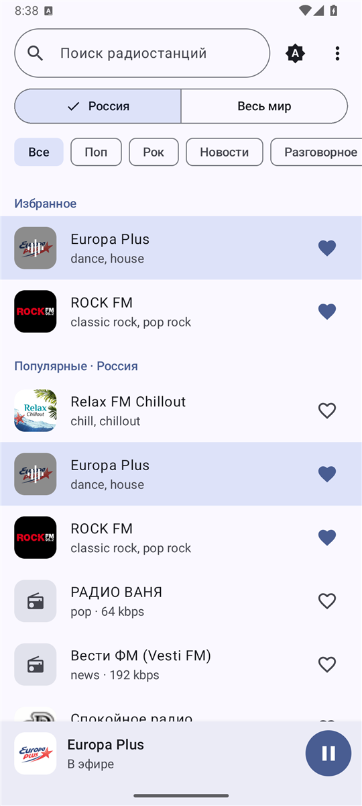
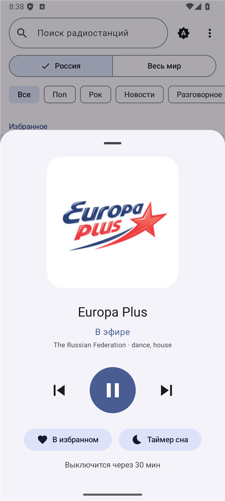
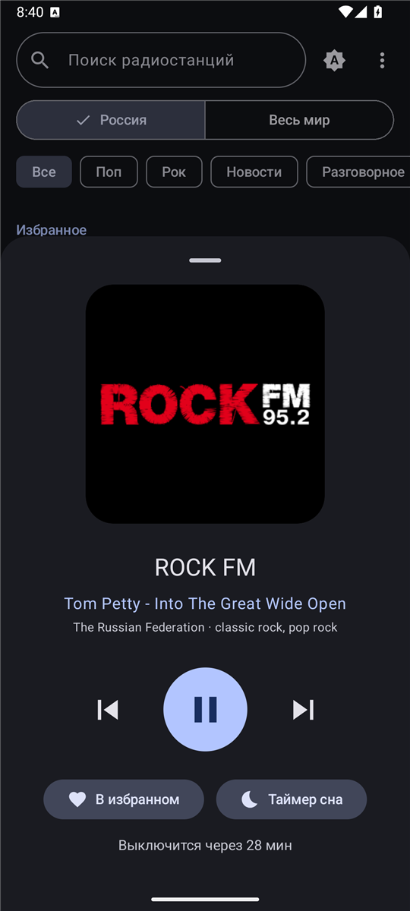
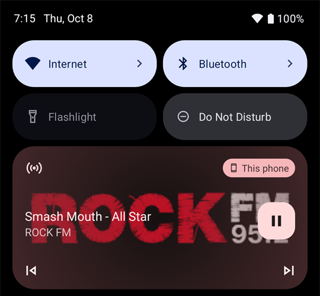
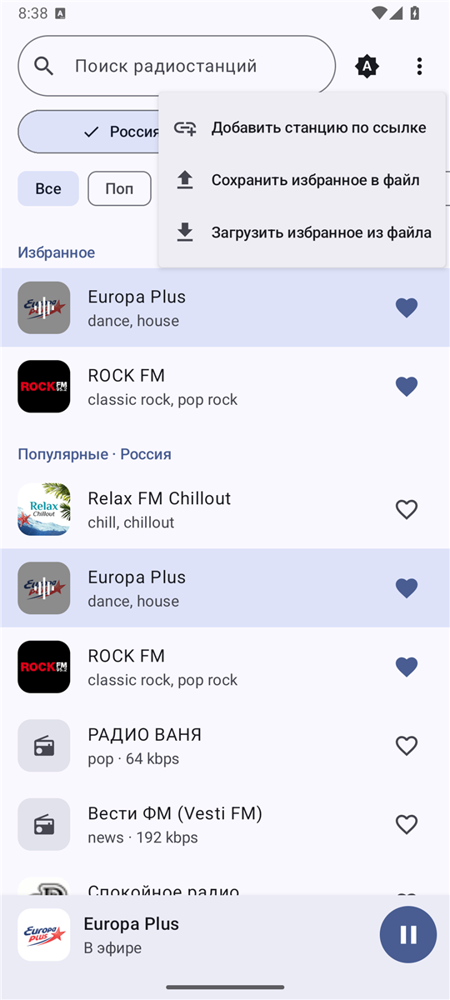
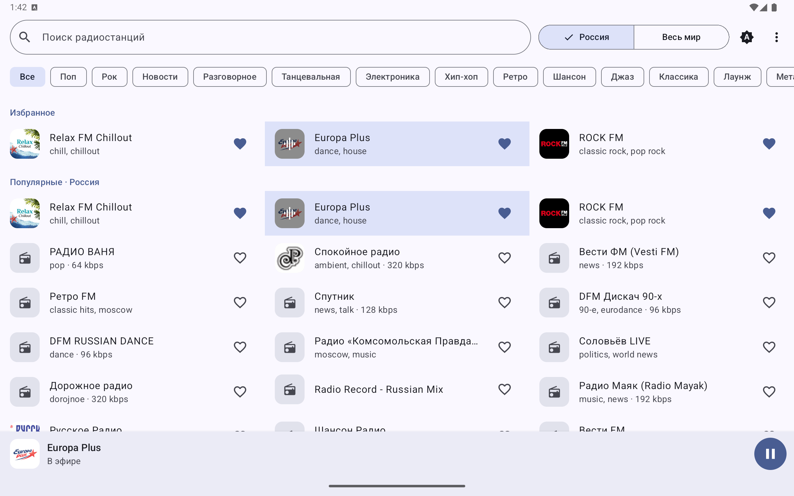
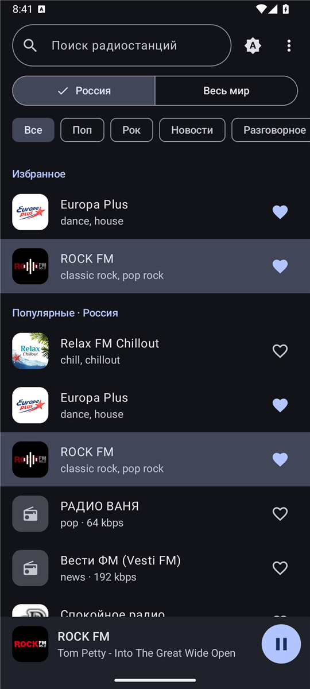

# RadioJeka

Тысячи радиостанций России и мира в одном простом приложении для Android. Работает без VPN, без регистрации и без рекламы.

<p>
  <a href="https://github.com/WiverHome/RadioJeka/releases/latest"></a>
  
  
  <a href="LICENSE"></a>
</p>

**[Скачать APK для Android](https://github.com/WiverHome/RadioJeka/releases/latest/download/RadioJeka.apk)** · [Сайт](https://wiverhome.github.io/RadioJeka/) · [Что нового](CHANGELOG.md) · [Все версии](https://github.com/WiverHome/RadioJeka/releases)

<p align="center">
  
  
  
</p>

## Почему RadioJeka

- **Открыл — слушаешь.** Один экран: выбрал станцию, она играет. Никаких аккаунтов и подписок.
- **15 199 станций без VPN.** Все станции России и самые популярные из 204 стран мира встроены в приложение: список открывается сразу, а редкие зарубежные станции находятся поиском, даже если сайты каталогов недоступны.
- **Играет в фоне.** Управление из уведомления, с экрана блокировки и кнопками наушников.
- **Засыпайте под радио.** Таймер сна выключит его через 15–90 минут.
- **Удобно на планшете.** На широком экране станции идут в две-три колонки, плеер помещается и в альбомной ориентации.
- **Ничего не собирает.** Звук идёт прямо с серверов станций, приложение ничего не отправляет.

## Возможности

### Станции России и всего мира

Переключатель «Россия / Весь мир», 14 категорий (поп, рок, новости, разговорное, танцевальная, электроника, хип-хоп, ретро, шансон, джаз, классика, лаунж, метал, фолк) и поиск по названию. Любимые станции отмечаются сердечком и всегда стоят наверху.

### Плеер и таймер сна

Полноэкранный плеер показывает название песни, если станция его передаёт. Кнопки «назад / вперёд» листают станции из списка. Таймер сна выключает радио через 15, 30, 45 минут, час или полтора — даже если приложение закрыто.

<p align="center">
  
</p>

### Своя станция по ссылке

Нет нужной станции в каталоге? Меню «⋮» → «Добавить станцию по ссылке», вставьте адрес потока — станция появится в избранном.

<p align="center">
  
</p>

### Перенос избранного

Меню «⋮» → «Сохранить избранное в файл», а на новом телефоне — «Загрузить избранное из файла». Станции добавятся к уже отмеченным, без повторов.

### Неотвечающие станции не мешают

Станция, которая не заиграла, приглушена, подписана «Не отвечает» и уходит в конец списка. Как только она снова заиграет, пометка исчезнет.

### На планшете и в альбомной ориентации

На широком экране станции выстраиваются в две-три колонки, а переключатель «Россия / Весь мир» встаёт рядом с поиском. Полный плеер на лежащем телефоне ставит логотип сбоку, чтобы все кнопки были видны.

<p align="center">
  
</p>

### Светлая и тёмная тема

Как в системе, всегда светлая или всегда тёмная. На Android 12 и новее цвета подстраиваются под обои (Material You).

<p align="center">
  
</p>

## Как установить

Нужен телефон с Android 8.0 или новее.

1. Скачайте **[RadioJeka.apk](https://github.com/WiverHome/RadioJeka/releases/latest/download/RadioJeka.apk)** на телефон.
2. Откройте скачанный файл. Если Android спросит, разрешите установку из этого источника (браузера или «Файлов»).
3. Нажмите **«Установить»**.

Google Play Защита может предупредить, что приложение ей незнакомо: оно распространяется не через Google Play. Нажмите «Подробнее» → «Всё равно установить».

Обновление — так же: скачайте новую версию и установите поверх, избранное и настройки сохранятся.

## Частые вопросы

**Это бесплатно?** Да. Без рекламы, подписок и покупок внутри.

**Откуда станции?** Из открытой базы [Radio Browser](https://www.radio-browser.info), которую ведут слушатели со всего мира. Снимок базы (Россия целиком и 15 тысяч самых популярных станций мира) встроен в приложение; когда сайт доступен, приложение раз в сутки обновляет его в фоне.

**Станция не играет или её нет.** Её можно исправить или добавить на [radio-browser.info](https://www.radio-browser.info) — она появится в RadioJeka после обновления каталога. Или добавьте её сами по ссылке на поток.

**На каком языке интерфейс?** На русском.

## Для разработчиков

Kotlin, Jetpack Compose (Material 3), Media3 / ExoPlayer, Coil.

```bash
./gradlew assembleRelease
```

APK появится в `app/build/outputs/apk/release/`. Без файла `keystore.properties` сборка подписывается отладочным ключом.

Юнит-тесты и тесты интерфейса на подключённом эмуляторе или телефоне (их же запускает CI на каждый push и PR):

```bash
./gradlew testDebugUnitTest
./gradlew connectedDebugAndroidTest
```

Обновить встроенный каталог перед выпуском (нужен доступ к radio-browser.info):

```bash
python tools/update_catalog.py
```

| Файл | Что внутри |
| --- | --- |
| `MainActivity.kt` | запуск приложения и тема |
| `RadioScreen.kt` | главный экран: поиск, фильтры, меню, список станций |
| `Player.kt` | мини-плеер, полный плеер, таймер сна |
| `AddStationDialog.kt` | диалог своей станции |
| `RadioViewModel.kt` | состояние экрана, очередь станций, связь с плеером, резервная копия |
| `PlaybackService.kt` | фоновое воспроизведение, уведомление, переподключение, название трека, таймер сна |
| `StationCatalog.kt` | встроенный каталог (`stations.json` при запуске, `stations_world.json` — редкие станции мира после показа списка), поиск и фильтры офлайн, ежедневное обновление |
| `RadioApi.kt` | запросы к Radio Browser |
| `SleepTimer.kt`, `CustomStation.kt`, `FavoritesBackup.kt`, `BrokenStations.kt` | логика функций 1.1.0, покрыта тестами в `app/src/test` |

## Лицензия

[MIT](LICENSE). Названия и логотипы радиостанций принадлежат их владельцам.
